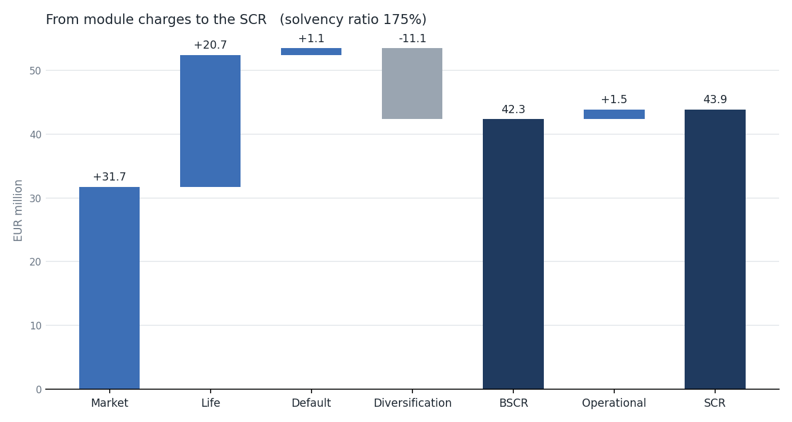

# Solvency II Standard Formula SCR Calculator

A simplified Python implementation of the Solvency II standard formula for a
synthetic life insurer. It builds the Solvency II balance sheet, runs the
market, life underwriting, counterparty default and operational risk modules,
aggregates them with the regulatory correlation matrices, and reports the SCR,
MCR and solvency ratio, with what-if sensitivities.

**Status:** version 1, a learning project. All data is synthetic.

## Run it

```bash
pip install numpy pandas matplotlib pytest
python data/generate.py     # creates the synthetic policies, annuitants and bonds
python report.py            # prints the results, saves output/ tables and chart
python -m pytest -q         # sanity checks
```

## Base results (EUR m)

| Item | Value |
|---|---|
| Assets | 435.0 |
| Best estimate liability | 340.3 |
| Risk margin (input) | 18.0 |
| Own funds | 76.7 |
| Market risk | 31.7 |
| Life underwriting risk | 20.7 |
| Counterparty default risk | 1.1 |
| Diversification between modules | -11.1 |
| Basic SCR | 42.3 |
| Operational risk | 1.5 |
| **SCR** | **43.9** |
| MCR (25% floor binds) | 11.0 |
| **Solvency ratio** | **175%** |



### Sensitivities

| Scenario | Solvency ratio |
|---|---|
| Base | 175% |
| Symmetric adjustment -10% | 188% |
| Symmetric adjustment +10% | 163% |
| 20% of type 1 equity moved to type 2 | 173% |
| Risk-free rates -100bp | 152% |
| Term assurance book doubled | 183% |

Doubling the term book adds own funds and mortality, lapse and catastrophe
risk, yet the SCR rises by only about EUR 1.8m: mortality risk on the term book
is negatively correlated (-0.25) with longevity risk on the annuities.

## The insurer

| Block | Size | Main risks |
|---|---|---|
| Term assurance | 10,000 policies, ages 25-55, sums assured 50k-500k | Mortality, lapse, catastrophe |
| Immediate annuities | 2,000 annuitants, ages 60-80 | Longevity, expense |
| Assets | Government and corporate bonds (AA to BBB), type 1 and 2 equity, property, cash, receivables | Interest rate, spread, equity, property, default |

Mortality is a synthetic Gompertz-Makeham basis (annuitants at 75% of it).
Cash flows are projected annually and discounted on a synthetic risk-free curve.

## How each module is calculated

| Module | Method |
|---|---|
| Interest rate | Up and down shocks applied to the curve; bonds and BEL revalued; the larger loss in own funds binds |
| Equity | Type 1 at 39% and type 2 at 49%, each plus the symmetric adjustment (bounded at +/-10%); combined at correlation 0.75 |
| Property | 25% fall in value |
| Spread | Market value x factor by credit quality step and modified duration; EEA government bonds carry no charge |
| Mortality / longevity | Mortality rates +15% / -20%, liabilities re-projected |
| Lapse | Worst of lapse up (x1.5), lapse down (x0.5) and 40% mass lapse |
| Expense | Expenses +10% and expense inflation +1 percentage point |
| Life catastrophe | +0.15 percentage points on mortality for the next 12 months |
| Counterparty (type 2) | 15% of receivables, 90% for intermediary receivables overdue more than 3 months |
| Operational | Max of 4% of earned life premiums and 0.45% of life technical provisions, capped at 30% of the BSCR |
| MCR | Simplified life linear formula, held within 25%-45% of the SCR and above the absolute floor |

All shocks and correlation matrices are in `params.py`, each with its article
reference in Delegated Regulation (EU) 2015/35.

## Simplifications and next steps

- **Parameters to verify.** Values were entered from the regulation's
  structure and should be checked against the official consolidated text,
  especially the interest rate shocks (recalibrated in the 2024/2025 review,
  phased in) and the spread factor bands.
- Risk margin is an input and is not recalculated under shocks (cost of capital
  falls from 6% to 4.75% from 2027).
- No loss-absorbing capacity of technical provisions or deferred taxes.
- Flat-extrapolated synthetic curve, no Smith-Wilson / UFR extrapolation, no
  volatility or matching adjustment.
- Not modelled: currency and concentration risk, type 1 counterparty exposures,
  look-through, health and non-life risk, disability and revision risk.
- Lapse risk is assessed at portfolio level rather than policy by policy.
- Own funds are assumed to be all Tier 1.

## Project structure

```
params.py          shocks and correlation matrices, with article references
curve.py           risk-free curve, interest rate shocks, discount factors
mortality.py       synthetic mortality basis
liabilities.py     cash flow projection and BEL
assets.py          bond valuation, durations, other assets
insurer.py         balance sheet
modules/           market, life, default, operational
aggregate.py       correlation aggregation
scr.py             BSCR, SCR, MCR, solvency ratio
report.py          tables, waterfall chart, sensitivities
data/generate.py   synthetic data
tests/             sanity checks
```
